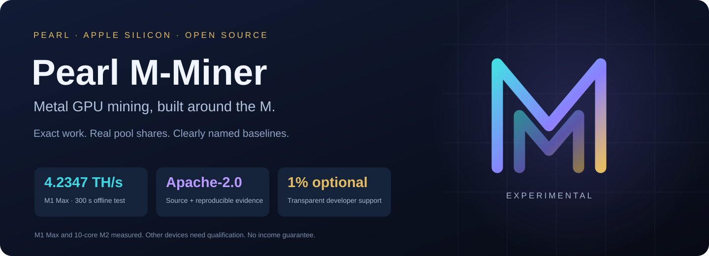
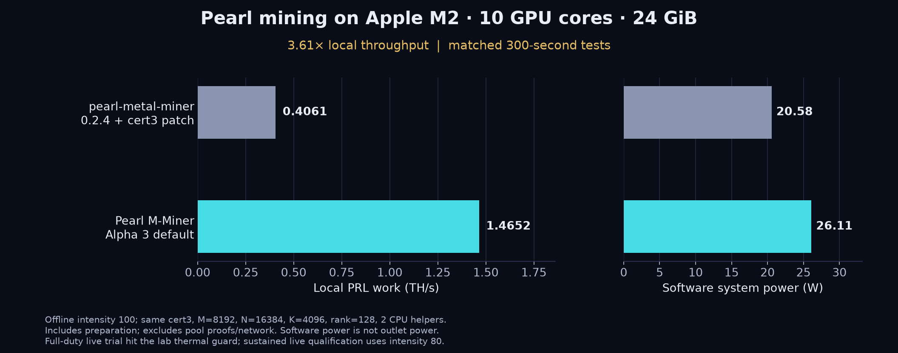

<p align="center"></p>

[English](README.md) · [简体中文](docs/README.zh-CN.md) · [日本語](docs/README.ja.md) · [한국어](docs/README.ko.md)

# Pearl M-Miner — Pearl (PRL) mining for Apple Silicon

Open-source Metal GPU mining for M-series Macs. **M1 Max: 4.2347 TH/s in a 300-second offline test, +7.82% versus our previous Alpha 2 backend.** A separate deployed user session produced a verified Kryptex gzip share. These are different measurements, not guaranteed pool speed or income.

<!-- m2-intro -->
New M2 evidence: **1.4652 TH/s on a 10-core GPU / 24 GiB Mac**, 3.61× the named upstream GPU control in matched 300-second offline tests. [Methods, pool checks and limits](docs/M2_VALIDATION_20261030.md).
<!-- /m2-intro -->

[What you get](#part-1) · [Requirements](#part-2) · [Build and verify](#part-3) · [Start mining](#part-4) · [Measured results](#part-5) · [Developer support and wallet](#part-6) · [For AI assistants and contributors](#part-7)

<a id="part-1"></a>

## What you get

- Exact prefix/S-matrix GPU backend, immutable jobs and official proof verification.
- Kryptex negotiated gzip-v2 and LuckyPool support.
- Readable local rate, accepted/rejected shares and job freshness.
- Optional, disclosed **1% of completed valid GPU scan time**.
- Foreground operation: no background service or autostart installed.

<a id="part-2"></a>

## Requirements

**Experimental source release v0.1.0-alpha.3 (Python package 0.1.0a3).** Requires Apple Silicon, **macOS 26+**, native arm64 **Python 3.12+**, Metal 4 Command Line Tools, Git and Rust/Cargo. Measured configurations include M1 Max (32 GPU cores / 64 GiB) and M2 (10 GPU cores / 24 GiB). For the tested M2 laptop, add --intensity 80 to the bounded mining command; see the thermal limits below. Other variants and M3–M5 remain experimental: run the local self-test, then validate the pool. CPU, ANE and multi-coin mining are not shipped features.

<a id="part-3"></a>

## Build and verify

```sh
git clone --branch v0.1.0-alpha.3 --depth 1 https://github.com/parkerkyle-max/pearl-m-miner.git
cd pearl-m-miner
sh bootstrap.sh
.venv/bin/pearl-m-miner info --json
.venv/bin/pearl-m-miner doctor
.venv/bin/pearl-m-miner self-test
.venv/bin/pearl-m-miner benchmark --seconds 60
```

The bootstrap builds the pinned official proof extension and creates a local virtual environment. It does not install mining autostart. If needed, use `PYTHON=python3.12 sh bootstrap.sh`. A failed build, precision guard or self-test must be resolved before mining. `info --json` is offline and portable; `doctor` checks the actual Mac. A changed build/device requires a fresh self-test.

<a id="part-4"></a>

## Start mining

```sh
.venv/bin/pearl-m-miner mine \
  --pool kryptex --address YOUR_KRX_MINING_ID \
  --worker my-mac --time-limit 600
```

```sh
.venv/bin/pearl-m-miner mine \
  --pool luckypool --address YOUR_PUBLIC_PRL_ADDRESS \
  --worker my-mac --time-limit 600
```

Replace placeholders with **your own public identity**. Kryptex uses your `krx…` mining ID; LuckyPool uses your native `prl1…` receiving address. The examples stop after ten minutes. Omit `--time-limit` for continuous foreground mining; **Ctrl+C stops the owned worker**. The default battery policy pauses, and serious/critical macOS thermal pressure pauses work. This OS signal is not a calibrated Celsius threshold. Never give the miner a seed, private key or wallet password.

<a id="part-5"></a>

## Measured results

The old Alpha 2 control mean was **3.9272 TH/s**; two candidate trials averaged **4.2344 TH/s**. The chosen shader sustained **4.2347 TH/s over 300 seconds** and passed 28 official proof checks, four production-size proof checks and 512 independent scan checks. A separate new-build live session recorded **1 accepted / 0 rejected**. Short share counts are not precise hashrate measurements. Wall power and net income were not measured.

The earlier **30–32%** M1 Max improvement was over our already-optimized 2.93–2.97 TH/s baseline. Historical M1 upstream/Pearly figures still use different windows. The new matched M2 upstream comparison appears below; Pearly was not retested.

[Data / 数据 / データ / 데이터](docs/M1_CEILING_20261030.md) · [Live evidence](docs/data/m1-pair32-live.json) · [Historical comparisons](docs/PERFORMANCE.md)

<!-- m2-results -->
### M2: matched 300-second comparison

On M2 (10 GPU cores, 24 GiB, macOS 27.0), the unchanged Alpha 3 default measured **1.4652 TH/s**, versus **0.4061 TH/s** for pearl-metal-miner 0.2.4 with cert3 compatibility and unchanged upstream GPU kernels: **3.61× (+260.8%)**. Both used M=8192/N=16384, two CPU helpers and 300 measured seconds. Alternatives did not establish a repeatable improvement, so the current kernel and defaults remain.



These are fresh-work offline rates, not pool payouts. The ideal 1% developer-time capacity adjustment is about 1.4506 TH/s; it is not measured net income. Power is software telemetry, not outlet power. The dated report records bounded pool trials, proof gates and the conditional arithmetic ceiling. Other M2 variants and M3–M5 need separate qualification. **Thermal limit observed:** the initial 100% live trial stopped at the lab’s 95°C sensor guard after about two minutes (2 accepted, 0 rejected). The repeated ten-minute pool tests use **80% intensity**. Start this laptop with `--intensity 80`; the 1.4652 TH/s offline headline is not a sustained live-rate promise.

```sh
.venv/bin/pearl-m-miner mine --pool luckypool \
  --address YOUR_PUBLIC_PRL_ADDRESS --worker my-m2 \
  --intensity 80 --time-limit 600
```

[Data / 数据 / データ / 데이터](docs/M2_VALIDATION_20261030.md)
<!-- /m2-results -->

<a id="part-6"></a>

## Developer support and wallet

We ask users and forks to retain the default 1% contribution: it funds device testing, correctness and maintenance. **It is optional; `--dev-fee 0` disables it.** This is not an Apache-2.0 license condition and not 1% of income. Pool fees are separate. The normal schedule is 3564 valid user scan seconds followed by 36 developer scan seconds; stale, paused and idle time do not add activity. Developer work uses a separate LuckyPool session, including when the user mines at Kryptex.

Public developer PRL receiving address (not your mining identity):

```text
prl1pwjessemugthkad9hkttcx2rvenux2q0w0xcah2j0a7zfrycjhz5qhn7apw
```

View this value with `pearl-m-miner info` or in `pearl_m_miner/devfee.py`. Your own rewards follow `--address`; the developer address receives only the optional developer work. Pool balances/payments and on-chain wallet balances are different. Visit LuckyPool and search the public address to inspect pool accounting; use a synced compatible wallet to inspect confirmed receipts. A miner does not manage wallet recovery.

[Fee details](docs/DEV_FEE.md) · [Wallet / pool guide](docs/WALLET_AND_PAYOUTS.md)

<a id="part-7"></a>

## For AI assistants and contributors

Use the machine-readable manifest and agent guide below. Ask the user for their public payout identity and mining authorization; never silently substitute the developer address, start mining, or conceal the fee. Keep local protocol rate, pool shares and income separate. No search ranking, AI recommendation, profitability or pool endorsement is promised.

[AI setup](docs/AI_SETUP.md) · [llms.txt](llms.txt) · [JSON manifest](docs/miner-manifest.json) · [FAQ](docs/FAQ.md)

[Strata study](docs/STRATA_REVIEW.md) · [Roadmap](docs/ROADMAP.md) · [Compatibility](docs/COMPATIBILITY.md) · [Contributing](CONTRIBUTING.md)

Copyright 2026 parkerkyle-max for modifications/additions. Apache-2.0; upstream attribution is preserved in NOTICE. Derived from pearl-metal-miner; not affiliated with Pearl Research Labs, Apple, Pearly or Strata. Strata informed a bounded scheduling experiment; its inference results are not mining results.

[LICENSE](LICENSE) · [NOTICE](NOTICE) · [Changelog](CHANGELOG.md)

[Alpha 3 validation](docs/ALPHA3_VALIDATION.md) · [Documentation website](https://parkerkyle-max.github.io/pearl-m-miner/)
