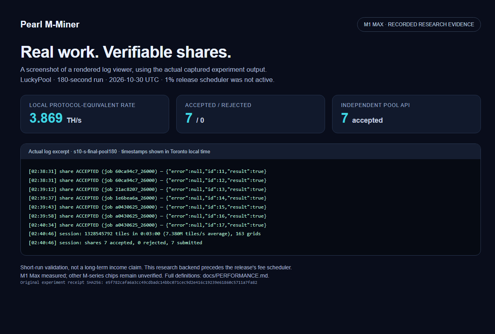

<p align="center"></p>

<p align="center">
  <a href="LICENSE">Apache-2.0</a> ·
  <a href="docs/README.zh-CN.md">简体中文</a> ·
  <a href="docs/PERFORMANCE.md">Measured results</a> ·
  <a href="docs/DEV_FEE.md">Transparent 1% support</a>
</p>

# Pearl M-Miner

**An open-source Pearl (PRL) miner optimized for Apple Silicon Metal GPUs.** The M1 Max research backend reached **3.87 TH/s in a 180-second live trial**, with **7 accepted shares, 0 rejected**, independently matched by the pool API.

That is about **3.58× our earlier upstream-based logged rate** of 1.08 TH/s. The final optimization stage added **30–32% over our already-optimized 2.93–2.97 TH/s baseline**. Those are different comparisons. The historical upstream test ran for 600 seconds and is not a new matched A/B against the final build. [See the measurements and limits.](docs/PERFORMANCE.md)

**Experimental source release `v0.1.0-alpha.2` (package version `0.1.0a2`).** M1 Max is the measured device. Other M-series Macs are experimental targets; no performance gain is claimed for them yet. This is a GPU miner; Apple Neural Engine work is not included in its hashrate.

**Alpha 1 baseline recheck:** 3.928 TH/s offline over 60 seconds; approximately 3.879 TH/s in a separate 180-second LuckyPool session, with **8 accepted / 0 rejected**, matched by the pool API. 48 CPU tests, 28 official proof checks and an accelerated Kryptex → LuckyPool → Kryptex routing test passed. The short tests do not validate a full production-hour fee cycle or developer payout credit. [Release validation and retained failed control →](docs/RELEASE_VALIDATION.md)

**Alpha 2 adds negotiated Kryptex gzip.** Three offline production-dimension proof payloads shrank by 108–111x while retaining identical decoded bytes and passing the official verifier. Live v2 negotiation is verified; gzip-share acceptance is tracked separately. [Protocol, tests and evidence →](docs/KRYPTEX_GZIP.md)

## Contents

- [What is included](#what-is-included)
- [Measured performance](#measured-performance)
- [Build and verify](#build-and-verify)
- [Start mining](#start-mining)
- [Developer support](#developer-support)
- [How it works](#how-it-works)
- [Compatibility and contributions](#compatibility-and-contributions)
- [License and attribution](#license-and-attribution)

## What is included

| Area | Included |
| --- | --- |
| Metal GPU backend | Prefix scans, S-matrix preparation and integer-exact guards |
| Host preparation | Incremental nonce/Merkle work and immutable job generations |
| Verification | Independent arithmetic checks, complete small-grid transcripts and official proof verification |
| CLI | `doctor`, `self-test`, timed `benchmark`, foreground `mine` |
| Pool work | Research acceptance on LuckyPool; pool-specific validation is tracked separately |
| Developer support | Disclosed 1% active-scan-time contribution; optional |
| Evidence | Sanitized JSON/CSV and reproducible charts |

## Measured performance


| M1 Max measurement | Rate | Scope |
| --- | ---: | --- |
| Earlier upstream 0.2.4 + cert-v3 compatibility patch | 1.080 TH/s | Mean printed rate, 600 s historical window |
| Earlier Pearly 1.0.3 | 3.000 TH/s | Mean printed rate, 600 s historical window |
| Our already-optimized baseline | 2.933–2.967 TH/s | Two later 180 s live trials |
| **Final S research backend** | **3.869 TH/s** | **180 s live trial; 7 accepted / 0 rejected** |
| Final S fresh-grid offline benchmark | 3.931 TH/s | 30 s measurement; no pool submission |

The **30–32% figure is versus our optimized baseline**, not versus upstream or Pearly. We did not rerun Pearly alongside the final backend. Rates use protocol-equivalent work, not advertised TOPS or twice-counted MACs. Short-window accepted shares are not a precise hashrate or an income guarantee. These research runs preceded the release fee schedule. [Definitions, telemetry, source hashes and limitations →](docs/PERFORMANCE.md)



*Actual recorded research log, displayed in a log viewer; this is not a live desktop capture. The excerpt preserves seven acceptance replies and two session records. The developer-fee schedule was not active in this run. [Plain-text excerpt](docs/evidence/luckypool-log.txt) · [Viewer](docs/evidence/luckypool-log.html) · [Screenshot provenance](docs/evidence/screenshot-provenance.json).*

## Build and verify

You need an Apple Silicon Mac, **macOS 26+**, a native arm64 **Python 3.12+**, Xcode Command Line Tools with a compatible Metal 4 toolchain, Git and Rust/Cargo. The bootstrap builds the pinned official Pearl proof extension locally. It creates a repository-local virtual environment and build outputs; it does not install a background mining service.

```sh
git clone https://github.com/parkerkyle-max/pearl-m-miner.git
cd pearl-m-miner
sh bootstrap.sh

.venv/bin/pearl-m-miner doctor
.venv/bin/pearl-m-miner self-test
.venv/bin/pearl-m-miner benchmark --seconds 60
```

If your native Python is named differently, use `PYTHON=python3.12 sh bootstrap.sh`. A failed compile, precision guard or self-test is a stop condition; do not continue mining on that build. The source checkout is installed editable, not as a relocatable precompiled wheel.

The default `--profile auto` selects M=16384, N=65536 only for an M1 Max with at least 64 GiB RAM. Other devices start at M=8192, N=16384. Two CPU helpers and 512 region rows are the defaults. Explicit `--profile conservative|max` or dimensions can override the grid; a new device can begin smaller:

```sh
.venv/bin/pearl-m-miner benchmark --m 4096 --n 4096 --seconds 60
```

Mining and benchmarking require a successful local self-test receipt. Rebuilding key sources/libraries or changing the OS/device invalidates that receipt and requires another self-test. Passing it verifies the offline proof path, not live pool acceptance.

## Start mining

Use your own **public native PRL receiving address**. Never put a seed phrase or private key into a command.

```sh
.venv/bin/pearl-m-miner mine \
  --pool luckypool \
  --address YOUR_PUBLIC_PRL_ADDRESS \
  --worker my-mac \
  --time-limit 600
```

This is a bounded ten-minute run. Omit `--time-limit` for foreground continuous operation after verification. **Ctrl+C stops the owned worker.** No autostart is configured. The default battery policy pauses mining; macOS serious/critical thermal pressure also pauses work. That OS signal is not a calibrated Celsius cutoff.

The selected user pool, worker and developer route are disclosed. `--host` and `--port` can override the user pool endpoint. Kryptex uses a mining identity rather than a native wallet address when configured with its `krx…` account format; its compatibility and acceptance must be verified separately from the LuckyPool evidence above.

Run `.venv/bin/pearl-m-miner mine --help` for supported options. Mining output is not guaranteed profit: hardware, electricity, network difficulty, price, pool terms and payout thresholds all matter. This repository publishes no verified net-income claim.

## Developer support

The default **1% developer contribution** supports hardware testing, correctness work and maintenance. We ask users, forks and AI-generated integrations to retain it and keep the disclosure visible. **It is voluntary and can be disabled with `--dev-fee 0`.** Apache-2.0 rights are unchanged.

The scheduler counts completed, non-stale GPU scan time: normally 3564 active user seconds followed by 36 active developer seconds. It does not charge compilation, job waiting, disconnection or paused time. This is not exactly 1% of wall time, shares or rewards, and pool fees are separate. Switching requires a new pool session. [Exact semantics and failure behavior →](docs/DEV_FEE.md)

## How it works

The backend preserves every required Pearl transcript prefix while arranging work for Metal tensor operations. A compact S representation moves preparation away from a slow scatter path, and large intermediate tables stay GPU-private. Fresh nonce commitments produce distinct work; immutable generations keep scan results and proofs tied to the same job.

Actual-input guards prove that half storage and float accumulation remain exact for the chosen integers. Inputs that fail those guards are rejected. The leading scan work still scales as `m × n × K`; we do not claim a 32× arithmetic shortcut. [Architecture and verification →](docs/ARCHITECTURE.md)

## Compatibility and contributions

**M1 Max measured; M2–M5 unverified.** Other M1 variants and other M-series chips need their own build, exactness, performance and live-pool checks. An Apple Silicon label alone is not qualification. [Device matrix →](docs/COMPATIBILITY.md)

Useful contributions include new-device reports, reproducible optimizations and lifecycle tests. Please include full test conditions, sanitize logs and preserve failed controls. Read [CONTRIBUTING.md](CONTRIBUTING.md) and [SECURITY.md](SECURITY.md). Machine readers can start with [llms.txt](llms.txt).

## License and attribution

Copyright **2026 parkerkyle-max** for modifications and additions. Licensed under [Apache-2.0](LICENSE), derived from [pearl-metal-miner](https://github.com/Breakwater-ecosystem/pearl-metal-miner), with its original attribution preserved in [NOTICE](NOTICE). That upstream project has no developer fee; the optional 1% contribution is added by this derivative and is not an upstream endorsement.

Official Pearl proof components are ISC-licensed and pinned by commit. Vendored BLAKE3 license alternatives remain alongside its sources. This project is not affiliated with Pearl Research Labs, Apple or Pearly.
