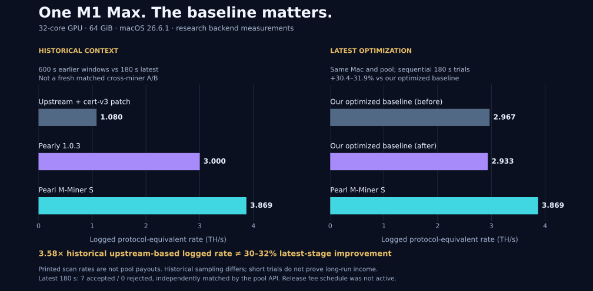

# Performance: three different baselines

All numbers below were measured on **one Apple M1 Max, 32-core GPU, 64 GiB unified memory, macOS 26.6.1, on AC power**. They describe the research backend that became Pearl M-Miner. Release packaging, fee routing and longer runs are separate validation steps.

## What the improvement means

| Comparison | Earlier result | Latest result | Supported statement |
| --- | ---: | ---: | --- |
| Earlier upstream-based miner → S backend | 1.080 TH/s | 3.869 TH/s | About **3.58×** the historical logged rate |
| Our already-optimized baseline, before → S backend | 2.967 TH/s | 3.869 TH/s | **+30.4%** local scan rate |
| Our already-optimized baseline, after → S backend | 2.933 TH/s | 3.869 TH/s | **+31.9%** local scan rate |

The **30–32% improvement is relative to our already-optimized baseline**, not the original upstream miner. The historical 3.58× comparison uses a different test window and configuration; it is not a fresh matched A/B or a promise of the same gain on another Mac.

The earlier upstream-based run used `pearl-metal-miner` 0.2.4 at commit `3d4cc7dadbd1de98ba20e9beb162806a0e70266b`, with our certificate-v3 compatibility patch. Calling it an entirely unmodified upstream binary would be inaccurate. It used the original blocked GPU route before our kernel and dataflow optimization work.

## Recent same-machine, same-pool trials

These were sequential 180-second LuckyPool trials, with distinct worker identities. The reported rates come from local scan logs, not a pool dashboard estimate.

| Backend | Local protocol-equivalent rate | Accepted / rejected | Duration |
| --- | ---: | ---: | ---: |
| Already-optimized baseline, before | 2.967 TH/s | 3 / 0 | 180 s |
| Already-optimized baseline, after | 2.933 TH/s | 7 / 0 | 180 s |
| Final S preparation + prefix scan | **3.869 TH/s** | **7 / 0** | **180 s** |

The final pool API independently matched all seven accepted shares after an initial aggregation delay. All 163 preparations reported method S. The final run completed 1,331,691,520 tiles and excluded 3,145,728 stale tiles (about 0.236%) from valid returned work. The older baseline's meter can include a scan that expires just as it finishes; the final S path checks the job again and excludes it. That boundary difference limits an overly precise comparison.

Seven accepted shares establish that this bounded run produced work accepted by the pool. They do not establish a precise pool hashrate, long-term uptime, a payment, or an income increase of the same percentage. In particular, seven versus three shares is not evidence of 2.33× performance.

## Historical upstream and Pearly comparison

The earlier upstream/Pearly pair used the same Mac and LuckyPool entrance, with 60 seconds of warm-up and a **600-second measurement window for each miner**, sequentially.

| Historical miner | Mean printed rate | Accepted / rejected in window | Declared developer fee then |
| --- | ---: | ---: | ---: |
| Upstream 0.2.4 + certificate-v3 compatibility patch | 1.080 TH/s | 8 / 0 | 0% |
| Pearly 1.0.3 | 3.000 TH/s | 16 / 0 | 2% |

These are arithmetic means of printed rates. The upstream readings use overlapping rolling windows; Pearly's timing denominator was not source-audited. Pearly was not modified or reverse engineered. It was not rerun alongside the final S implementation, so this repository does **not** claim a new, matched 29% victory over Pearly.

The historical difficulty-weighted share estimates were 1.489 TH/s for upstream and 4.373 TH/s for Pearly. We do not use those noisy short-window estimates as deterministic throughput bars. The Pearly window also had a difficulty change. Pool shares, printed scan rates and sustained earned rewards remain different measurements.

## Offline result and measurement units

The final fresh-grid benchmark at M=16384, N=65536, K=4096, rank=128 measured **3.931 TH/s over 30.002 seconds**, after six seconds of warm-up. It includes new-grid preparation and returned scans, but excludes pool networking and hit-triggered proof submission. It is separate from the 3.869 TH/s live trial.

For our layout, one tile corresponds to `2 × 64 × 4096 = 524288` protocol work units. Reported TH/s is `tiles/s × 524288 / 10^12`. A multiply-accumulate is counted once; multiplication and addition are not counted twice to inflate the result. This is not SHA-256 calls per second, GPU TOPS, or the throughput of a repeated-input matrix microbenchmark.

## Power and income

| Recent live run | CPU telemetry | GPU telemetry | System telemetry |
| --- | ---: | ---: | ---: |
| Already-optimized baseline, before | 3.32 W | 41.92 W | 68.43 W |
| Final S backend | 1.11 W | 48.60 W | 63.11 W |

These are software estimates over the supervised capture, including startup. They are **not outlet measurements**. Display, fans, background activity and thermal history can affect them. We do not use this table to claim measured electricity savings or net profit.

The research trials above did not run the release's developer-fee schedule. Do not label the displayed rates as net user earnings after a developer fee. A 1% time allocation is also not an exact 1% share count or revenue allocation. A release fee cycle and sustained user-side work should be measured separately.

## Reproducible evidence

- [Recorded LuckyPool research-log screenshot](../assets/luckypool-log.png), [plain text](evidence/luckypool-log.txt), [log viewer](evidence/luckypool-log.html) and [provenance hashes](evidence/screenshot-provenance.json): nine preserved records, including seven acceptance replies and two session records, from the final S research run. The screenshot renders a recorded excerpt; it is not a live desktop capture. The release developer-fee schedule was not active.
- [Machine-readable JSON](data/performance.json) and [CSV](data/performance.csv): sanitized values, definitions, limitations and source-artifact SHA256 identifiers.
- [Chart generator](generate_performance_charts.py): regenerates the published SVG and PNG from the JSON, without invented samples.
- [Architecture](ARCHITECTURE.md): exactness guards, preserved transcript semantics and immutable job generations.

Private device names, local account paths, network addresses, wallet addresses and pool credentials are excluded from the public extract. Source hashes identify the retained original artifacts; the extract is not a claim that a public third party independently witnessed these measurements. Failed candidates and component timings were not promoted to the results table.

## Packaged release recheck

The separately built release reproduced 3.928 TH/s offline and approximately 3.879 TH/s in a 180-second LuckyPool trial (8 accepted, 0 rejected, API matched). Its tests and source changes, including the retained 3.359 TH/s benchmark control, are documented in [release validation](RELEASE_VALIDATION.md). The historical comparison bars above remain tied to their original measurements.
